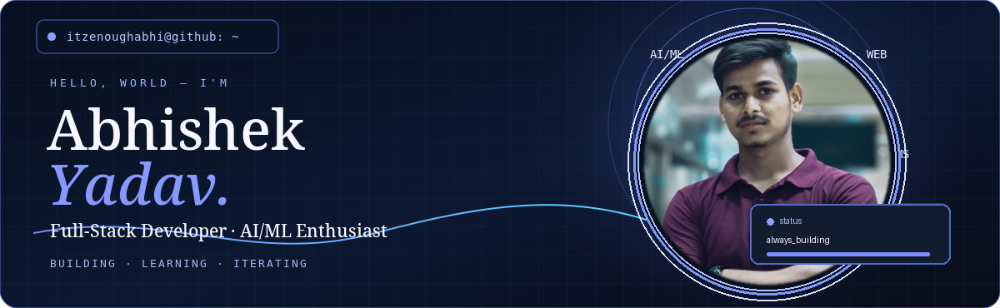
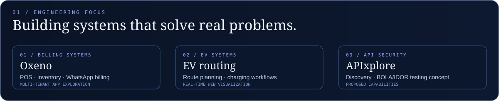
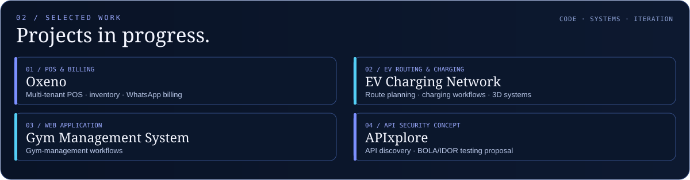
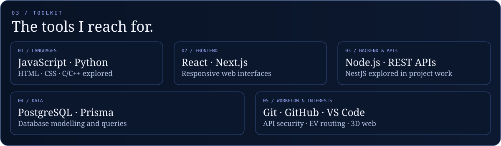

  
  

### Building useful products with code — from full-stack platforms to real-time systems.

---

## About Me

Hi, I'm **Abhishek Yadav**, a B.Tech student at **Mumbai University, Maharashtra**. I enjoy building web applications and exploring how software, APIs, databases, and real-time systems work together.

- 💻 Interested in **full-stack development**, backend systems, and practical product engineering.
- 🧩 Working with technologies including **JavaScript, React, Next.js, Node.js, PostgreSQL, Prisma, and REST APIs**.
- 🚗 Exploring **EV charging, route planning, and 3D web visualisation**.
- 🛠️ I value clear interfaces, useful features, and systems that solve real problems.

---

## Recognition & Project Focus

  

*This section highlights project focus rather than claiming awards or certifications.*

---

## Selected Projects

  

- **Oxeno — Multi-tenant POS & WhatsApp Billing:** billing, inventory, customer records, and WhatsApp bill delivery. Project work has explored Next.js/React, Node.js/NestJS, PostgreSQL, Prisma, and tenant data isolation. *Work in progress; public demo link not yet added.*
- **EV Charging Network / Smart Route for EV Vehicles:** [Open repository](https://github.com/itzenoughabhi/smart-route-for-ev-vehical). The older `ev-vehical-power-station` URL currently redirects to this repository, so it is listed once to avoid a duplicate.
- **Gym Management System:** [Open repository](https://github.com/itzenoughabhi/gym-management-system)
- **APIxplore:** API discovery, BOLA/IDOR testing, health checks, and schema-drift detection are proposed project capabilities; don't assume each is implemented without checking the project.

---

## Toolkit

  

---

## Current Learning Focus

- Multi-tenant application design and data isolation
- API design, authentication, authorization, and BOLA/IDOR risks
- EV routing and charging-station workflows
- 3D web interfaces and maintainable software architecture

## GitHub Activity

Explore my repositories and contribution history on [GitHub](https://github.com/itzenoughabhi). I avoid hard-coded contribution totals, streaks, rankings, or statistics that have not been verified.

---

**Keep building. Keep learning. Keep shipping.**

Built with curiosity · Updated as projects evolve

